# 🛒 CommerceLens — Automated E-commerce Analytics & Sentiment

**Python · SQL · Pandas · Streamlit · Plotly · Sentiment · Data quality · CI**

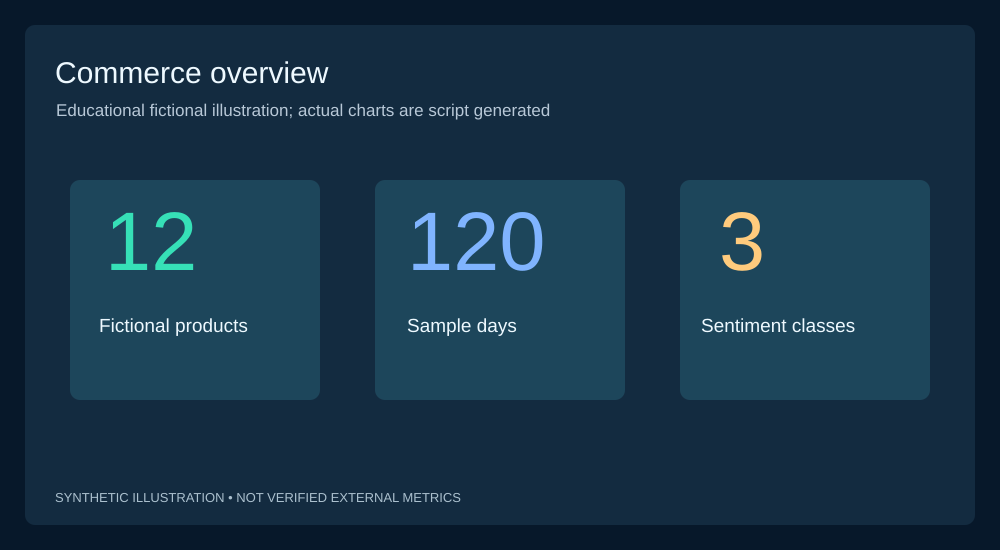

An end-to-end portfolio analytics project: generated or authorized CSV → validated observations → sentiment baseline → SQLite → KPI queries → interactive dashboard → ten exportable data-driven charts.

> **Data provenance:** Default data is fully synthetic (12 fictional products × 120 days = 1,440 product-day observations, plus simulated reviews). Estimated revenue uses synthetic units, not actual customer purchases. Sentiment is not a validated ML accuracy claim. No live retailer integrations or web scraping.

## Workflow
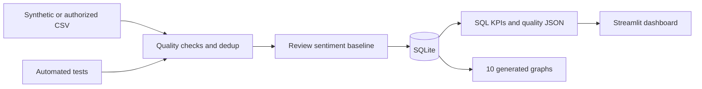

## Quick start
```bash
git clone https://github.com/harshakavali81-collab/Automated-E-commerce-Analytics-Sentiment.git
cd Automated-E-commerce-Analytics-Sentiment
python -m unittest discover -s tests -v
python -m src.pipeline.run --demo
python -m pip install -r requirements.txt
streamlit run dashboard/app.py
python -m src.analytics.charts
```

To import licensed CSVs (columns in data dictionary):
```bash
python -m src.pipeline.run --prices /path/prices.csv --reviews /path/reviews.csv
```

## Features
- Deterministic synthetic fixture generation and optional authorized CSV sources.
- Reject invalid prices/ratings/dates; account for discarded/duplicated rows.
- Negation-aware rule sentiment labels: positive, neutral and negative.
- SQLite snapshot with constraints and indexed SQL analytics including window functions.
- Date/category filters, interactive charts, downloadable product comparisons and honest provenance.
- Unit tests and end-to-end CI on every push; three executable notebooks.
- **Ten original SVG project visuals** plus **ten repeatable Matplotlib charts** created from the processed database.

## Gallery — 10 illustrations (NOT externally measured retail data)

| Illustration | Illustration |
|---|---|
|  | 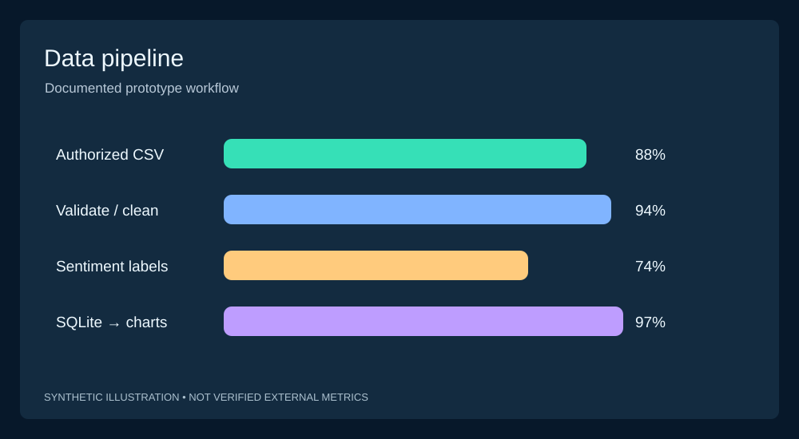 |
| 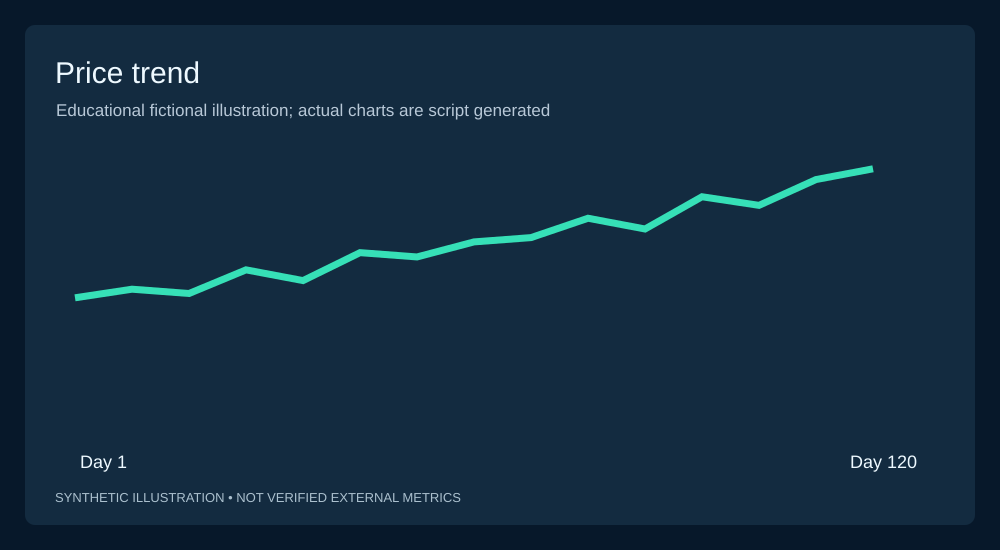 | 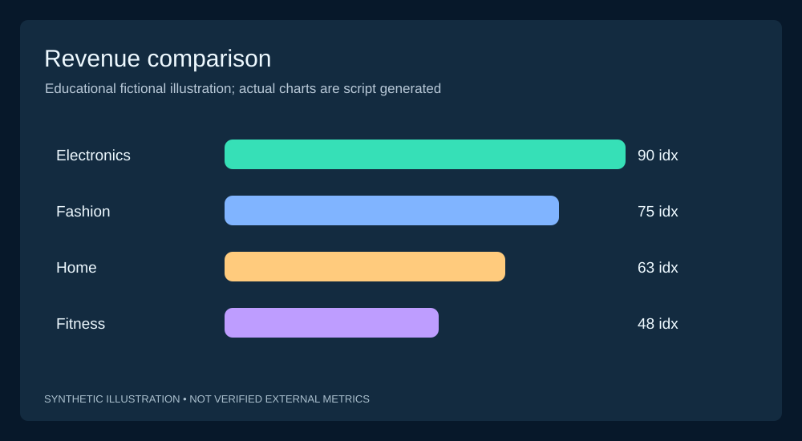 |
| 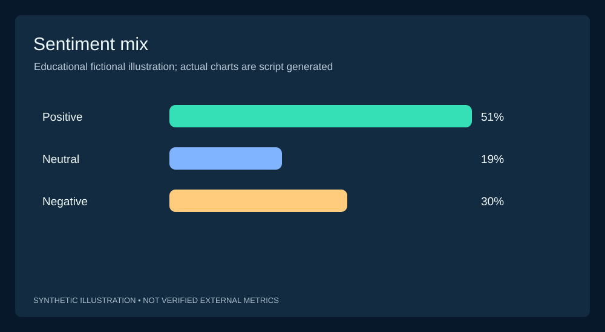 | 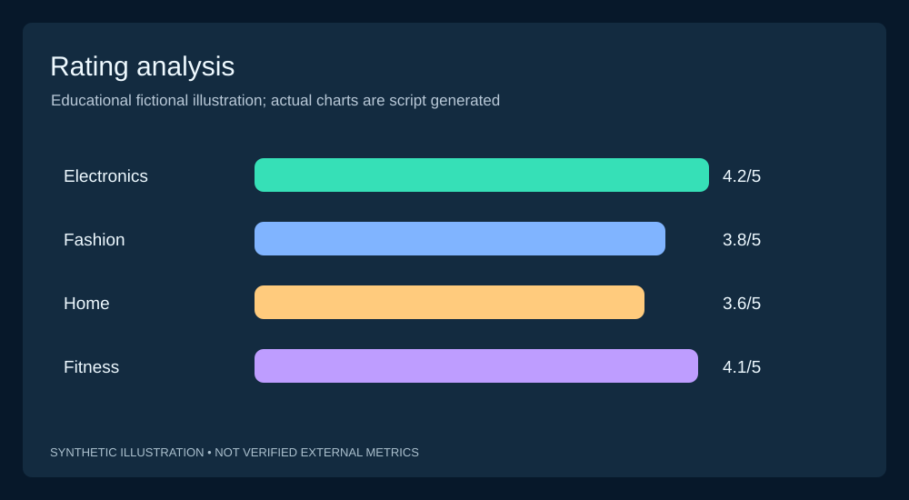 |
| 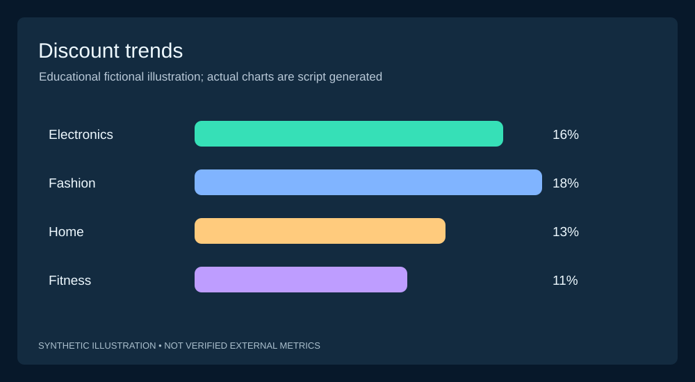 | 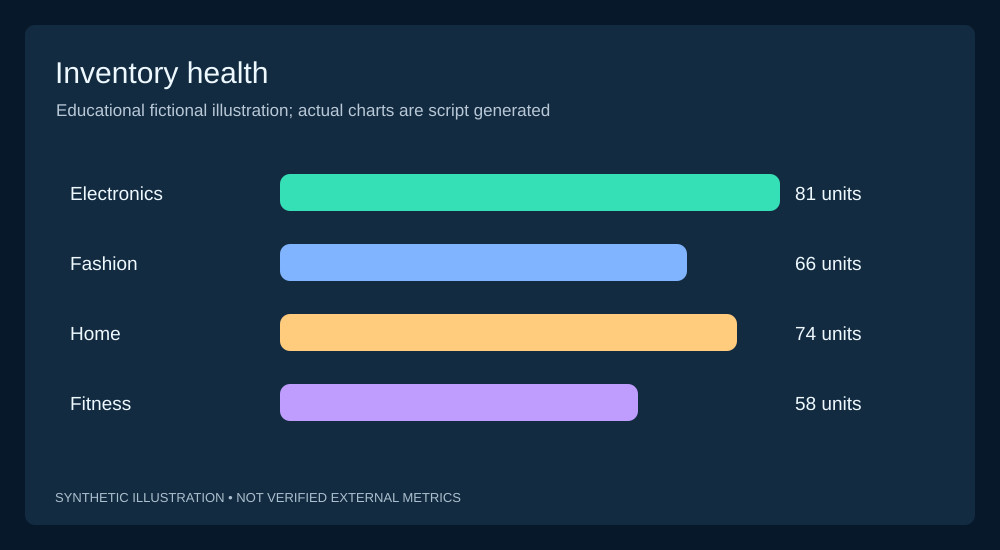 |
| 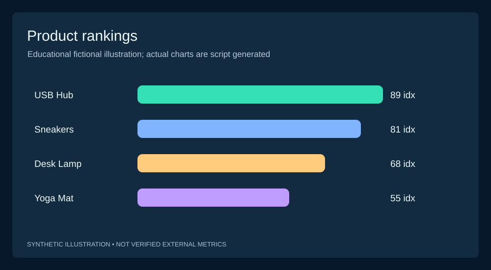 | 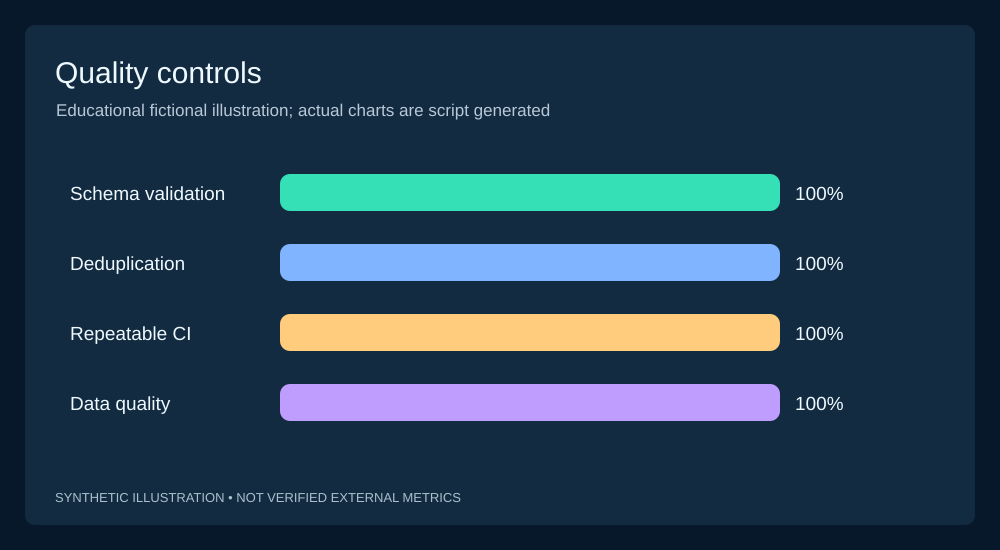 |

## Technical documentation
[Architecture](docs/ARCHITECTURE.md) · [Data dictionary](docs/DATA_DICTIONARY.md) · [Validation](docs/VALIDATION.md) · [Deployment](docs/DEPLOYMENT.md) · [Portfolio case study](docs/PORTFOLIO_CASE_STUDY.md) · [Tree](docs/PROJECT_TREE.txt) · [SQL KPIs](sql/kpis.sql)

## Scope and known limitations
Default prices, units and reviews are synthetic; this does not demonstrate measured revenue, sentiment prediction accuracy, real-time refresh or market scraping. A public Streamlit deployment and genuine authorized retailer feed are **not configured**. Imported third-party data require permission, privacy review and source verification.
